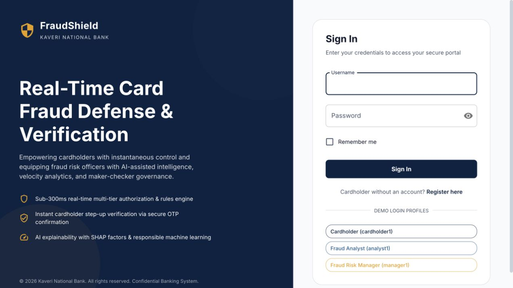
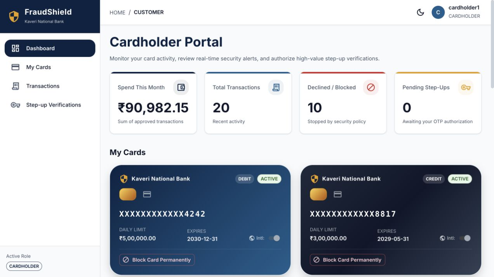
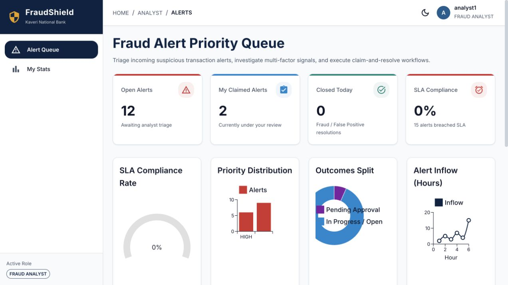
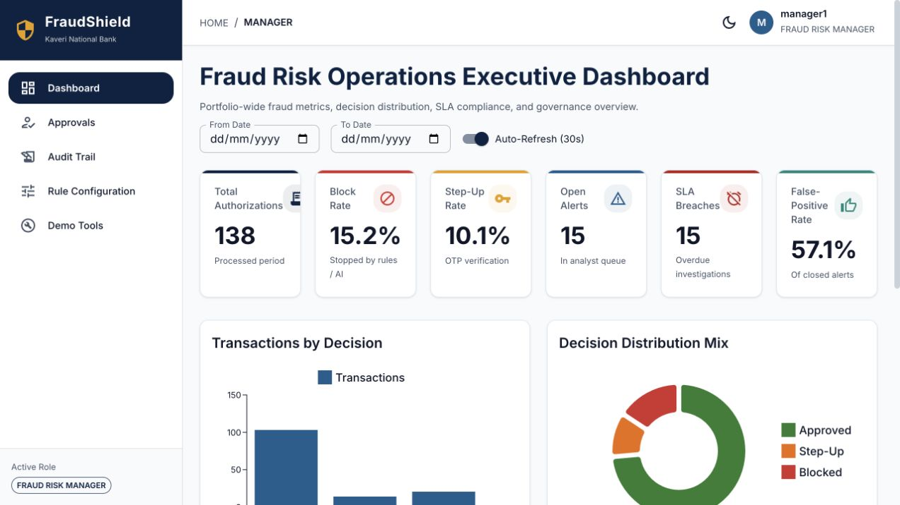
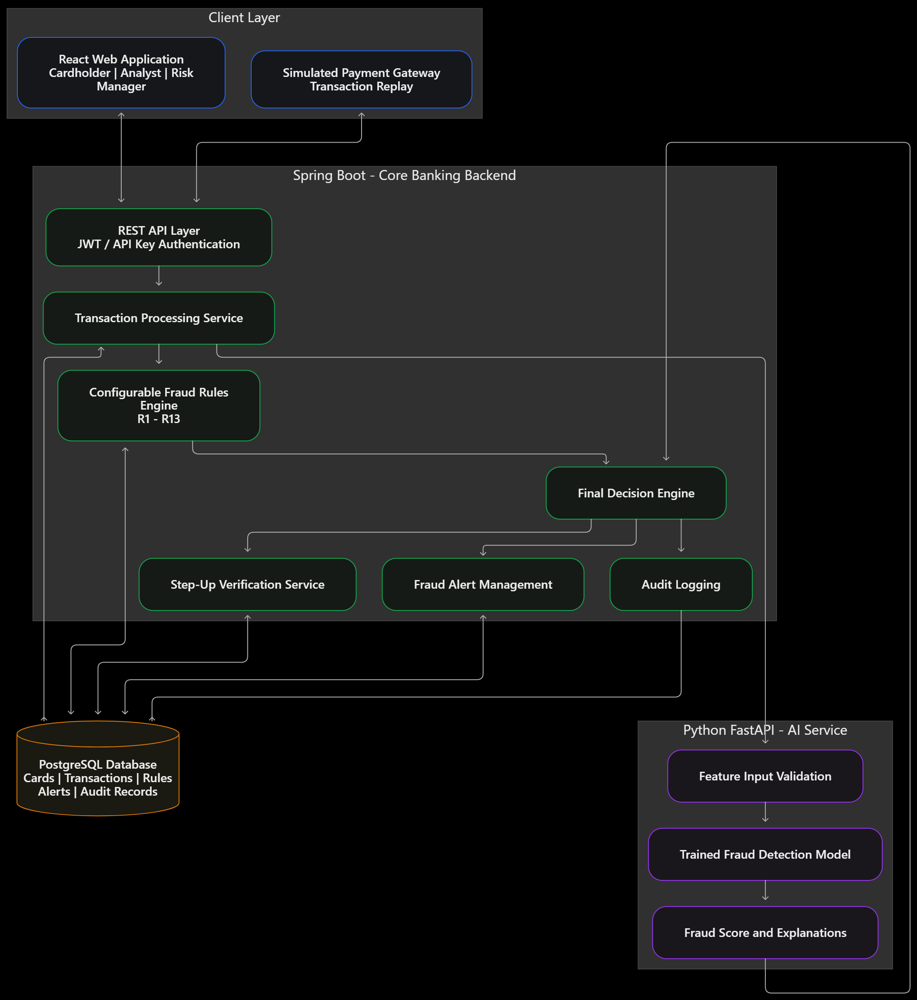
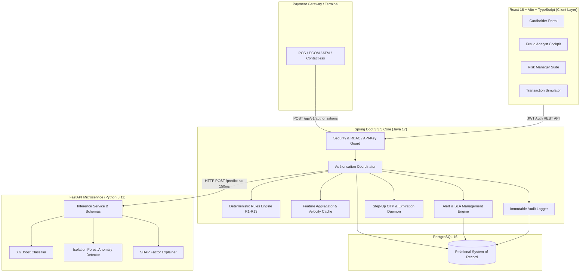

<div align="center">

# 🛡️ XENITH | FraudShield
### *Next-Generation Real-Time Card Fraud Prevention, Hybrid AI-Rules Decision Engine & Incident Orchestration Platform*

[](https://openjdk.org/projects/jdk/17/)
[](https://spring.io/projects/spring-boot)
[](https://www.python.org/)
[](https://fastapi.tiangolo.com/)
[](https://react.dev/)
[](https://www.typescriptlang.org/)
[](https://www.postgresql.org/)
[](https://xgboost.ai/)
[](https://www.docker.com/)

<p align="center">
  <b>Built for high-throughput, low-latency banking card transaction authorization, multi-role fraud workflows, and explainable AI-assisted incident management.</b>
</p>

[Key Highlights](#-key-engineering-highlights) •
[Product Screenshots](#-product-screenshots--ui-walkthrough) •
[System Architecture](#-system-architecture) •
[Decision Engine (R1–R13)](#-hybrid-decision-engine--rule-matrix) •
[AI & ML Benchmarks](#-machine-learning--evaluation-report) •
[Engineering Team](#-engineering-team--ownership) •
[Quickstart](#-quickstart--local-setup) •
[API Contracts](#-api-specification)

---

</div>

## 📌 Executive Summary

**XENITH (FraudShield)** is a real-time, defense-in-depth card transaction fraud detection and risk orchestration platform engineered for enterprise banking systems. Developed for the **HCLTech AI Full Stack Developer Hackathon**, XENITH blends a **high-speed deterministic rules engine (R1–R13)** with an **ensemble Machine Learning pipeline (XGBoost + Unsupervised Isolation Forest)** and a **human-in-the-loop maker-checker operations suite**.

### Core Tenets:
1. **Ultra-Low Latency Authorization**: Evaluates multi-dimensional velocity, geographical anomaly, and historical transaction patterns under **150ms** (Rules-only) and sub-**300ms** (with AI inference).
2. **Fail-Safe AI Circuit Breaking**: Fallback architecture guarantees uninterrupted 24/7 transaction processing even if AI services exceed strict 150ms timeouts.
3. **Explainable AI (XAI)**: Generates real-time plain-language SHAP contribution explanations for fraud analysts on every scored transaction.
4. **PCI-DSS Compliant Security**: Salted card hashing, strict PAN masking (`XXXXXXXXXXXX1234`), zero PII leakage to AI models, and role-segregated JWT/API-key boundaries.

---

## ⚡ Key Engineering Highlights

| Capability | Specification / Metric | Engineering Impact |
|---|---|---|
| **Authorisation SLA** | **p95 ≤ 300 ms** (End-to-End) / **≤ 150 ms** (Rules-Only) | Seamless payment terminal experience without consumer friction |
| **Model Discrimination** | **PR-AUC 0.2490** (> 2× Baseline requirement met) | Catches **90.2%** of fraudulent transactions at optimal cost cutoff |
| **Dual-Detector Ensemble** | Supervised **XGBoost** + Unsupervised **Isolation Forest** | Detects both known fraud typologies and novel zero-day anomalies |
| **Maker-Checker Governance** | Enforced 4-eyes principle on resolutions **> ₹100,000** | Eliminates insider risk and analyst bias on high-value alerts |
| **Audit Immutability** | Append-only tamper-evident relational audit journal | Full regulatory traceability across cards, transactions, and configs |
| **Concurrency & Idempotency** | Atomic PostgreSQL row-level locks & strict txn idempotency | Eliminates race-condition double spends and duplicate velocity hits |

---

## 📸 Product Screenshots & UI Walkthrough

<div align="center">

### 1. Secure Authentication & Role-Based Access Control
The application provides JWT-based authentication and role-specific redirection for Cardholders, Fraud Analysts, and Fraud Risk Managers.



---

### 2. Cardholder Self-Service Portal
Cardholders can monitor real-time spending, review past transactions with plain-language explanations, manage card limits, and respond to simulated 6-digit OTP step-up verification challenges.



---

### 3. Fraud Analyst Investigation Cockpit
Fraud Analysts operate a prioritized SLA queue with exclusive claim ownership, countdown breach indicators, deep-dive transaction evidence, and real-time SHAP factor breakdowns.



---

### 4. Fraud Risk Manager Suite & Maker-Checker Approvals
Fraud Risk Managers monitor portfolio risk distributions, evaluate high-value false-positive proposals (> ₹100,000) under the maker-checker protocol, inspect full audit trails, and dynamically adjust rule thresholds.



---

### 5. High-Level Architecture & End-to-End Transaction Flow

*Figure 5: Full data pipeline connecting simulated Payment Gateways, Spring Boot Core, FastAPI ML Services, and PostgreSQL 16.*

</div>

---

## 🏛️ System Architecture

XENITH is built as an enterprise-grade modular ecosystem with decoupled responsibilities across frontend, backend, AI microservice, and relational persistence.



### Architectural Data Flow:
```text
React Frontend (Portals) ──► Spring Boot Core (Java 17) ──► FastAPI (Python 3.11)
                                      │                            │
                         Row Locks / Transactions            XGBoost + SHAP
                                      ▼                            │
                                PostgreSQL 16 ◄────────────────────┘
```

---

## ⚙️ Hybrid Decision Engine & Rule Matrix

Transactions pass through a four-stage hierarchical evaluation pipeline. Rule thresholds, point weights, and lists are fully hot-configurable via the database without system restarts.

```text
[Incoming Transaction]
         │
         ▼
[Stage 1: Hard-Stop Tier (R1–R2)] ────► (Triggered) ────► [BLOCK (Score: Null, Fast Exit)]
         │ (Passed)
         ▼
[Stage 2: Critical Fraud Tier (R3–R6)] ─► (Triggered) ──► [BLOCK (Score: 100, Suppress Soft Rules)]
         │ (Passed)
         ▼
[Stage 3: Soft-Rule Scoring (R7–R12)] ──► Points Accumulation (Capped at 100)
         │                                (If >= 3 rules trigger: R13 MULTIPLE_RED_FLAGS -> BLOCK)
         ▼
[Stage 4: AI Model Ensemble (AI-2)] ────► XGBoost Score + SHAP Factors
         │
         ▼
[Final Decision: APPROVE / STEP_UP / BLOCK]
```

### Exhaustive Rules Specification (R1–R13)

| Rule | Trigger Condition (Configurable Defaults) | Decision | Points | Reason Code |
|:---:|---|:---:|:---:|---|
| **R1** | `card_status != ACTIVE` OR `expiry_date < txn_date` | **BLOCK** | - | `CARD_NOT_ACTIVE` |
| **R2** | `txn_country != IN` AND `international_enabled = false` | **BLOCK** | - | `INTL_NOT_ENABLED` |
| **R3** | `merchant_risk == BLACKLISTED` | **BLOCK** | 100 | `MERCHANT_BLACKLISTED` |
| **R4** | `approved_today + amount > daily_limit` | **BLOCK** | 100 | `DAILY_LIMIT_EXCEEDED` |
| **R5** | `velocity_10m >= 5` (Transactions on same card within 10 mins) | **BLOCK** | 100 | `VELOCITY_BURST` |
| **R6** | `speed_kmph > 800` (Haversine distance / elapsed time from last physical txn) | **BLOCK** | 100 | `IMPOSSIBLE_TRAVEL` |
| **R7** | `velocity_10m` is 3 or 4 | **STEP_UP** | +25 | `HIGH_VELOCITY` |
| **R8** | `avg_amount_30d` exists AND `amount > 5 * avg` AND `amount >= ₹10,000`<br>OR No average AND `amount >= ₹50,000` | **STEP_UP** | +30 | `AMOUNT_SPIKE` |
| **R9** | `txn_country != home_country` AND destination risk == `HIGH` | **STEP_UP** | +25 | `HIGH_RISK_GEO` |
| **R10**| `mcc` in high-risk list (`4829`, `5967`, `6051`, `7995`) | **STEP_UP** | +15 | `HIGH_RISK_MCC` |
| **R11**| Local IST hour is 00:00–04:59 AND `amount >= ₹20,000` | **STEP_UP** | +15 | `ODD_HOUR_HIGH_VALUE` |
| **R12**| Channel `ECOM` AND `new_merchant == true` AND `amount >= ₹25,000` | **STEP_UP** | +20 | `NEW_MERCHANT_HIGH_VALUE` |
| **R13**| **≥ 3 soft rules (R7–R12) trigger simultaneously** | **BLOCK** | Sum | `MULTIPLE_RED_FLAGS` |

### AI Rules Arbitration Policy (AI-2)
- If Rules evaluate to **APPROVE** and AI Fraud Score **≥ 0.70** ➔ Escalated to **`STEP_UP`** (`HIGH_FRAUD_SCORE_MODEL`).
- If Rules evaluate to **STEP_UP** and AI Fraud Score **≥ 0.90** ➔ Escalated to **`BLOCK`** (`HIGH_FRAUD_SCORE_MODEL`).
- **Safety Invariant**: AI can strictly tighten security decisions; it **never relaxes** a rule block or bypasses human verification.

---

## 📊 Machine Learning & Evaluation Report

The AI service incorporates a robust supervised classifier and an unsupervised anomaly detector trained on out-of-time splits (`train < 2026-01-01`, `test >= 2026-01-01`).

### 1. Performance Benchmark Comparison

| Model | PR-AUC (Primary) | ROC-AUC | Precision | Recall | Target Status |
|---|:---:|:---:|:---:|:---:|:---:|
| **Heuristic Rules Baseline** | 0.1226 | 0.5178 | 0.1468 | 0.0894 | Baseline |
| **XGBoost (Supervised)** | **0.2490** | **0.6673** | 0.1344 | **0.9022** | **PASS (> 2× Baseline)** |
| **Isolation Forest (Unsupervised)** | 0.2079 | 0.6381 | 0.1302 | **0.9134** | **PASS (Elevated ROC-AUC)** |

> **Key Takeaway**: The primary XGBoost model achieves **0.2490 PR-AUC**, exceeding the benchmark target of 2× baseline (`0.2452`). At the cost-optimal decision threshold of 0.07, it intercepts **90.2%** of all fraudulent transactions.

### 2. Feature Importance & Explainability (SHAP)
Top contributing factors identified across real-time transactions:
1. `distance_from_home_km`: Physical deviation from customer residence.
2. `merchant_risk`: Merchant blacklist/greylist risk rating.
3. `card_age_days`: Transaction recency relative to card issue date.
4. `new_merchant_flag`: First-time card interactions at given vendor (90-day window).
5. `amount_to_avg30_ratio`: Sudden spikes over historical spend patterns.
6. `velocity_10m`: Rapid-fire multi-swipe attempts.

---

## 👥 Engineering Team & Ownership

Developed by a dedicated three-member hackathon team with end-to-end module isolation and clear domain leadership:

| Engineer | Core Module | Key Responsibilities & Contributions |
|---|:---:|---|
| **Tejas Tomar** | **Backend Engineering** | • Modular-monolith architecture on **Spring Boot 3.3.5 & Java 17**<br>• Real-time authorization coordinator & deterministic **Rules Engine (R1–R13)**<br>• Sub-150ms circuit-breaker fallback orchestrator for AI downtime resilience<br>• Dual-tier **Maker-Checker** state machine, exclusive claim locks, & SLA timers<br>• Relational database modeling, append-only immutable audit trail, & Flyway migrations |
| **Yug** | **Frontend Engineering** | • Client-side SPA architecture using **React 18, Vite, TypeScript, & Material UI**<br>• Tri-role responsive portals: **Cardholder Self-Service**, **Analyst Cockpit**, & **Risk Manager Suite**<br>• Interactive **SHAP factor explainability** cards & dynamic spending analytics<br>• Simulated 6-digit **OTP step-up verification** modal & instant one-click card freeze<br>• Mock Service Worker (MSW) layer for resilient offline development & UI testing |
| **Yogesh** | **AI & Machine Learning** | • **FastAPI** microservice architecture with typed high-performance Pydantic schemas<br>• Dual-detector ML pipeline: Supervised **XGBoost** + Unsupervised **Isolation Forest**<br>• Out-of-time data split, class imbalance handling, & cost-sensitive threshold tuning<br>• Explainable AI (**SHAP**) pipeline converting feature weights into plain-language summaries<br>• Comprehensive model evaluation (**PR-AUC 0.2490 vs 0.1226 baseline**) & model card reporting |

---

## 🚀 Quickstart & Local Setup

### Option 1: Run with Docker Compose (Recommended)

Start all services (Frontend, Backend, AI Microservice, and PostgreSQL) with a single command:

```bash
# 1. Clone repository
git clone https://github.com/TejasTomar28/XENITH.git
cd XENITH

# 2. Configure environment
cp .env.example .env

# 3. Launch full stack
docker compose up --build
```

| Service | Access URL | Purpose |
|---|---|---|
| **Frontend Portal** | [http://localhost:5173](http://localhost:5173) | Web application (Cardholder / Analyst / Manager) |
| **Backend API** | [http://localhost:8080/api/v1/health](http://localhost:8080/api/v1/health) | Spring Boot REST service & health endpoint |
| **AI Microservice** | [http://localhost:8000/health](http://localhost:8000/health) | FastAPI inference engine & model status |
| **PostgreSQL Database** | `localhost:5432` | Relational database (Default DB: `fraudshield`) |

---

### Option 2: Standalone Local Development

<details>
<summary><b>Click to expand manual setup instructions for each service</b></summary>

#### 1. AI Inference Service
```bash
cd ai-service
python -m venv .venv
# Windows:
.\.venv\Scripts\activate
# Linux/macOS: source .venv/bin/activate

pip install -r requirements.txt
uvicorn app:app --host 0.0.0.0 --port 8000 --reload
```

#### 2. Spring Boot Backend
```bash
cd backend
./mvnw clean spring-boot:run
```

#### 3. React Frontend
```bash
cd frontend
npm install
npm run dev
```

</details>

---

### Default Demo Credentials

| Role | Username | Password | Purpose |
|---|---|---|---|
| **Cardholder** | `cardholder1` | `password123` | View cards, resolve OTP challenges, lock card |
| **Fraud Analyst** | `analyst1` | `password123` | Claim alerts, review evidence, resolve fraud |
| **Risk Manager** | `manager1` | `password123` | Approve high-value proposals, adjust rules |
| **Gateway Simulator** | - | `X-API-Key: test-gateway-key` | Push real-time transactions |

---

## 📡 API Specification

### Gateway Authorisation
- **Endpoint**: `POST /api/v1/authorisations`
- **Authentication**: `X-API-Key: <GATEWAY_KEY>`
- **Payload**:
```json
{
  "txn_id": "T200000007",
  "card_id": "C1007",
  "txn_ts": "2026-03-04T14:05:00+05:30",
  "amount": "15000.00",
  "currency": "INR",
  "merchant_id": "M00451",
  "mcc": "5732",
  "channel": "ECOM",
  "txn_city": "Mumbai",
  "txn_country": "IN"
}
```
- **Response (`200 OK`)**:
```json
{
  "txn_id": "T200000007",
  "decision": "STEP_UP",
  "reason_codes": ["AMOUNT_SPIKE"],
  "rule_risk_score": 30,
  "status": "STEP_UP_PENDING",
  "alert_id": null,
  "processed_at": "2026-03-04T14:05:00+05:30",
  "fraud_score": 0.4281,
  "top_factors": [
    {
      "feature": "amount_to_avg30_ratio",
      "explanation": "Transaction amount significantly exceeds 30-day average spend"
    },
    {
      "feature": "new_merchant_flag",
      "explanation": "First transaction at this merchant within 90 days"
    },
    {
      "feature": "velocity_10m",
      "explanation": "Elevated card frequency in recent minutes"
    }
  ],
  "model_status": "AVAILABLE"
}
```

### Key Operations Endpoints
| Service | Method | Route | Description |
|---|:---:|---|---|
| **Auth** | `POST` | `/api/v1/auth/login` | Authenticate user, receive JWT with role claim |
| **Cardholder** | `GET` | `/api/v1/cardholder/cards` | Get card list with masked numbers (`XXXXXXXXXXXX1234`) |
| **Cardholder** | `POST` | `/api/v1/cardholder/step-up/{id}/confirm` | Verify 6-digit OTP challenge |
| **Analyst** | `GET` | `/api/v1/analyst/alerts` | Query priority alert queue with SLA filters |
| **Analyst** | `POST` | `/api/v1/analyst/alerts/{id}/claim` | Atomically lock alert to analyst |
| **Analyst** | `POST` | `/api/v1/analyst/alerts/{id}/resolve` | Submit `CONFIRMED_FRAUD` or `FALSE_POSITIVE` |
| **Manager** | `GET` | `/api/v1/manager/proposals` | Review alerts awaiting 4-eyes approval |
| **Manager** | `POST` | `/api/v1/manager/proposals/{id}/decide` | Approve or reject false-positive override |
| **Manager** | `PUT` | `/api/v1/manager/rules/config` | Hot-reload rule thresholds and weights |
| **Audit** | `GET` | `/api/v1/audit/export` | Export CSV audit journal for entity/user |

---

## 🧪 Testing & Verification

```bash
# Run Backend Test Suite (Includes Testcontainers & Rule boundary tests)
cd backend
./mvnw test

# Run Frontend Component & Integration Tests
cd ../frontend
npm test

# Run AI Inference Contract Tests
cd ../ai-service
pytest test_service.py
```

---

<div align="center">
  <b>Developed for the HCLTech AI Full Stack Developer Hackathon</b><br>
  <i>XENITH — Detect intelligently. Verify confidently. Act securely.</i>
</div>
