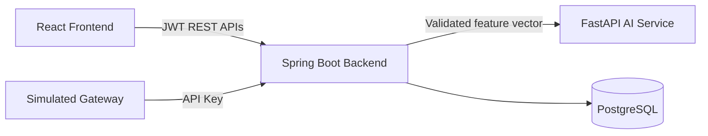

# 🛡️ XENITH — FraudShield

### AI-Assisted Real-Time Card Fraud Detection and Risk Management

FraudShield is a full-stack banking fraud detection prototype created for the **HCLTech AI Full Stack Developer Hackathon**. It combines configurable fraud rules, historical transaction analysis, machine-learning risk scoring, step-up verification, fraud alert investigation, and maker-checker approval workflows.

> FraudShield uses fictional banking scenarios and synthetic data. It does not process real payments or connect to card networks.

## Product Screenshots

### Cardholder Portal

Cardholders can monitor spending, review transactions, manage cards, and respond to pending step-up verifications.


### Fraud Analyst Dashboard

Fraud Analysts receive a prioritized investigation queue with claim ownership, SLA tracking, evidence, and resolution workflows.


### Fraud Risk Manager Dashboard

Fraud Risk Managers can monitor portfolio metrics, approve high-value false-positive proposals, inspect audit trails, and manage rule configuration.


### Secure Login

The application provides JWT-based authentication and role-specific access for Cardholders, Fraud Analysts, and Fraud Risk Managers.


## How FraudShield Works

FraudShield evaluates each transaction using:

- Historical card activity
- Configurable fraud rules R1–R13
- XGBoost fraud-risk predictions
- Card, merchant, city, country, and MCC reference data
- Role-based investigation and approval workflows

Every authorization produces one of three decisions:

| Decision | Meaning |
| --- | --- |
| `APPROVE` | Allow the transaction |
| `STEP_UP` | Require cardholder verification |
| `BLOCK` | Decline the transaction |

Spring Boot owns the final authorization decision. AI may escalate risk but never relaxes a rules-based decision.

## Architecture



- **React frontend:** Cardholder, Fraud Analyst, Fraud Risk Manager, and transaction demonstration views.
- **Spring Boot backend:** Authentication, fraud rules, historical features, workflows, persistence, audit, and final decisions.
- **FastAPI service:** XGBoost inference with three contributing factors.
- **PostgreSQL:** System of record for users, cards, transactions, alerts, verification requests, configuration, and audit events.

## Technology Stack

| Layer | Technology |
| --- | --- |
| Frontend | React 18, TypeScript, Vite, Material UI, React Query |
| Backend | Java 17, Spring Boot 3, Maven, Spring Security |
| Database | PostgreSQL 16, Spring Data JPA, Hibernate, Flyway |
| AI service | Python 3.11, FastAPI, XGBoost, SHAP |
| Authentication | JWT, role-based access control, gateway API key |
| Testing | JUnit 5, Testcontainers, Vitest, Testing Library |
| Containers | Docker and Docker Compose |
| Frontend server | Nginx |

## Core Features

### Real-Time Authorization

- Secured simulated-gateway endpoint
- Request and reference-data validation
- Transaction-ID idempotency
- Historical feature calculation
- Configurable R1–R13 fraud rules
- AI-assisted escalation
- Atomic persistence and audit events
- Rules-only fallback when AI is unavailable

### Historical Risk Features

The backend calculates transaction velocity, daily approved spending, 30-day average amount, geographic travel speed, merchant familiarity, local IST hour, country risk, home distance, and card age.

### AI-Assisted Detection

The FastAPI service returns a fraud probability, model version, and exactly three contributing factors. The backend applies these escalation thresholds:

| Rules decision | AI condition | Final decision |
| --- | --- | --- |
| `APPROVE` | Score ≥ 0.70 | `STEP_UP` |
| `STEP_UP` | Score ≥ 0.90 | `BLOCK` |
| `BLOCK` | Any score | `BLOCK` |

If inference fails or exceeds the backend deadline, FraudShield records `MODEL_UNAVAILABLE` and uses the rules-only result.

### Step-Up Verification

A suspicious transaction can enter `STEP_UP_PENDING`. A six-digit simulated OTP is written to a restricted development log. A correct, timely confirmation approves the transaction. `NOT_ME` blocks both the transaction and card. Unanswered requests expire after the configured period.

### Alert Investigation

Fraud Analysts can view prioritized alerts, monitor SLA deadlines, claim alerts exclusively, inspect transaction evidence, and resolve investigations as `CONFIRMED_FRAUD` or `FALSE_POSITIVE`.

### Maker-Checker Approval

A false-positive resolution for an amount strictly above **₹100,000** requires Fraud Risk Manager review. The system records the proposing analyst, reviewing manager, comments, timestamps, and final outcome.

## Roles

| Role | Access |
| --- | --- |
| Cardholder | Own cards, transactions, and step-up requests |
| Fraud Analyst | Alert queue and investigation workflows |
| Fraud Risk Manager | Dashboard, approvals, configuration, and audit |
| Simulated Gateway | Transaction authorization endpoint only |

## Repository Structure

```text
.
├── backend/                 # Java 17 Spring Boot service
├── frontend/                # React and TypeScript application
├── ai-service/              # FastAPI inference and training pipeline
├── data/                    # Approved development datasets
├── docs/                    # Architecture, contracts, and screenshots
├── output/                  # Evaluation and design outputs
├── scripts/                 # Development utilities
├── .env.example             # Environment-variable template
├── docker-compose.yml       # Full local stack
└── README.md
```

## Run the Application

### Prerequisites

- Docker Desktop
- Docker Compose

### Configure the environment

```bash
cp .env.example .env
```

Replace every `change-me` value. For the local quick-login buttons, set the three development passwords to `password123`. Use strong local values for the database password, JWT secret, gateway API key, and internal AI key. Never commit `.env`.

### Start all services

```bash
docker compose up --build
```

| Service | URL |
| --- | --- |
| Frontend | http://localhost:5173 |
| Backend health | http://localhost:8080/api/v1/health |
| AI health | http://localhost:8000/health |
| PostgreSQL | localhost:5432 |

Stop the environment with:

```bash
docker compose down
```

## Testing

### Backend

```bash
cd backend
./mvnw verify
```

Docker must be available for PostgreSQL Testcontainers.

### Frontend

```bash
cd frontend
npm ci
npm run typecheck
npm test -- --run
npm run build
```

### AI service

```bash
cd ai-service
python3 -m venv .venv
. .venv/bin/activate
pip install -r requirements.txt
python -m unittest -v test_service.py
```

Synthetic-model metrics validate the pipeline only. They are not evidence of production fraud-detection performance.

## Security and Privacy

- Full card numbers are never stored, displayed, logged, or sent to the AI model.
- Cards use a salted hash and last-four representation.
- Secrets are supplied through environment variables.
- Browser-visible configuration contains no privileged credentials.
- Cardholders can access only their own resources.
- AI features exclude direct customer identifiers.
- Audit events are appended through controlled workflows.

## Current Limitations

- The official case-study CSV/JSON data pack is not included.
- Official expected-output parity cannot be claimed until those fixtures are supplied.
- The bundled demonstration model is trained on generated synthetic data.
- OTP delivery, the transaction gateway, and notifications are simulated.
- Production deployment, regulatory certification, and live banking integrations are outside the prototype scope.

## Team

Developed by a three-member hackathon team with primary ownership divided across frontend, backend, and AI development.

**Repository:** [TejasTomar28/XENITH](https://github.com/TejasTomar28/XENITH)

## Disclaimer

FraudShield is an educational prototype. It is not a production payment gateway, fraud-control system, or financial product.

---

**XENITH — Detect intelligently. Verify confidently. Act securely.**
